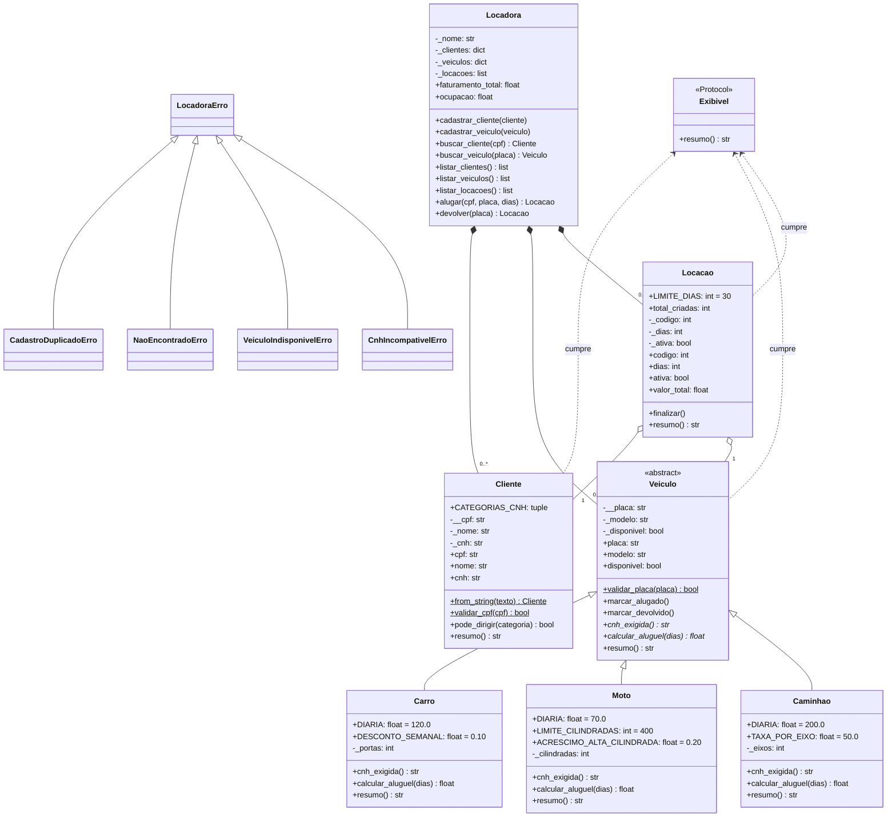

# Diagrama de Classes – Locadora de Veículos

## Legenda

| Símbolo | Significado |
|---|---|
| `<\|--` | Herança ("é um") |
| `*--` | Composição: a `Locadora` possui os objetos |
| `o--` | Agregação: a `Locacao` referencia um cliente e um veículo que existem por conta própria |
| `<..` | O `Protocolo` é cumprido sem herança |
| `$` | Método estático ou de classe |
| `*` | Método abstrato |
| `-` / `+` | Atributo protegido ou privado / público |
